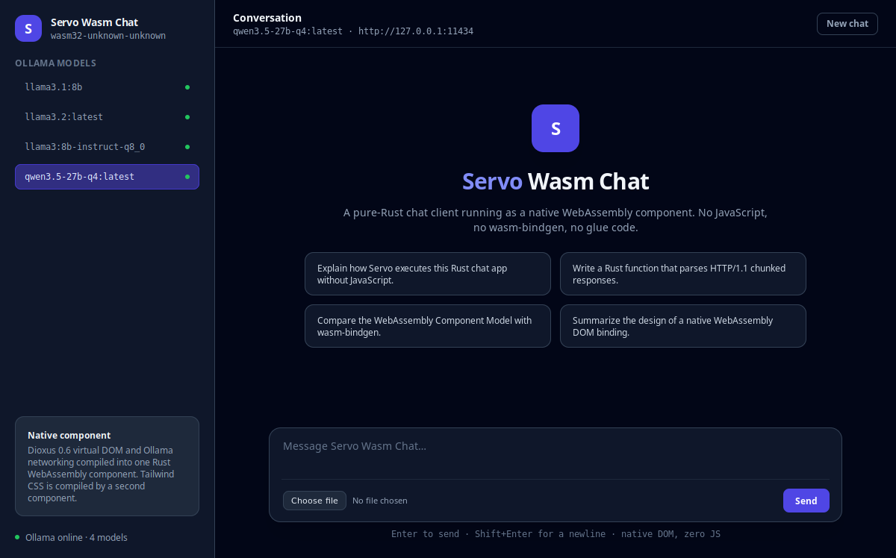
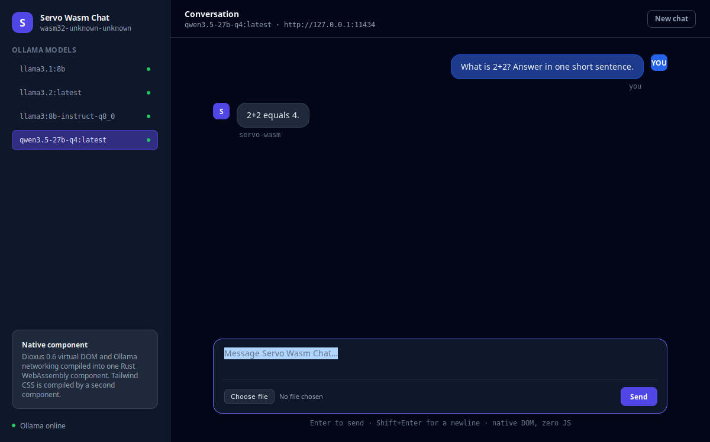

# Servo Wasm Chat

A ChatGPT-style chat client written entirely in Rust:

- **UI:** `dioxus-core` 0.6 virtual DOM, patched directly into Servo's native
  DOM through the `servo:dom` WIT interface.
- **Styling:** [railwind](https://github.com/tannal/railwind) is built as a
  separate `railwind.wasm` component.  The Servo host collects the app's
  Tailwind class tokens and asks railwind to compile them into a stylesheet.
- **Backend:** any Ollama server (default `http://127.0.0.1:11434`), including
  local GGUF models such as `qwen3.5-27b-q4`.
- **Artifacts:** two `wasm32-unknown-unknown` modules, componentized by
  `cargo component`: the Dioxus app and the railwind compiler. No JavaScript,
  no wasm-bindgen, no JS glue code.

## Screenshots





## Build the components

```sh
# In this repository
cargo component build --release --target wasm32-unknown-unknown
cp target/wasm32-unknown-unknown/release/wasm_guest.wasm chat.wasm

# In the railwind repository
cargo component build --release --target wasm32-unknown-unknown
cp target/wasm32-unknown-unknown/release/railwind.wasm .
```

## Run in Servo

Start a static server in this directory:

```sh
python3 -m http.server 8000
```

Then use a Servo build that contains the native component-model runtime:

```sh
servoshell http://127.0.0.1:8000/chat.html
```

`chat.html` contains no JavaScript, no application CSS and no application
markup. The entire loader is:

```html
<script src="chat.wasm"></script>
<script src="railwind.wasm"></script>
```

Components are recognised by their magic bytes, so no `type` attribute is
needed.  The two scripts may load in either order.

## Ollama

The app discovers models from `/api/tags` and talks to `/api/chat` using
non-streaming JSON.  Point Ollama at a local GGUF if necessary:

```
FROM /path/to/Qwen3.5-27B-Q4_K_M.gguf
PARAMETER num_ctx 8192
```

```sh
ollama create qwen3.5-27b-q4 -f Modelfile
```

Images selected with the file picker are read through Servo's `Blob` store and
sent as base64 `images` entries in the Ollama chat request.  Vision support
depends on the selected model.

## Layout

- `wit/servo_dom.wit` — the ABI shared with the Servo host.
- `src/bindings.rs` — generated by `cargo component bindings`.
- `src/chat.rs` — application state, Ollama protocol, attachments.
- `src/dioxus_renderer.rs` — `WriteMutations` → native DOM.
- `railwind.wasm` — the separate Tailwind component.
- `chat.html` — the minimal two-script loader.
